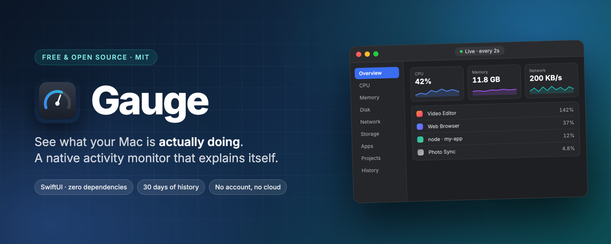
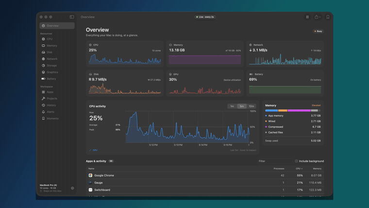
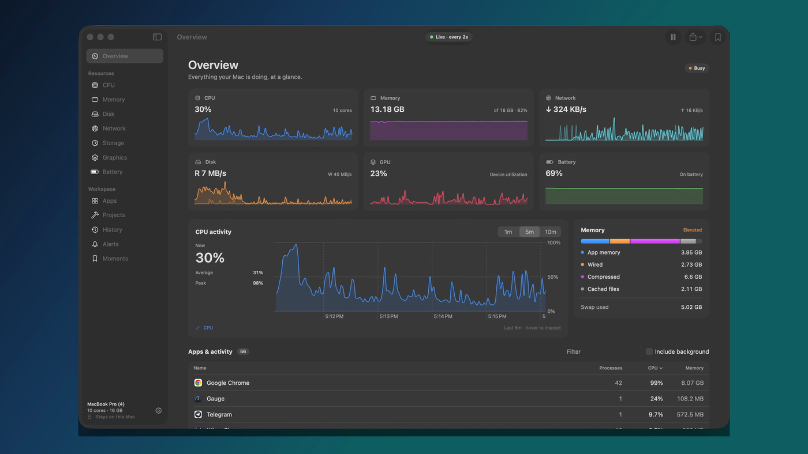
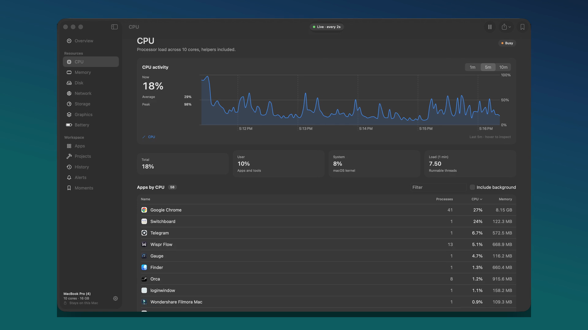
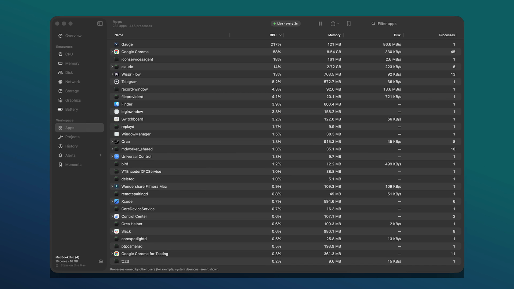
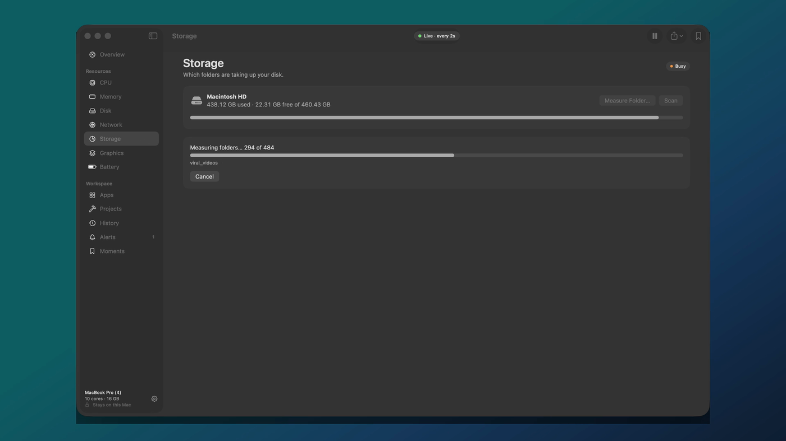
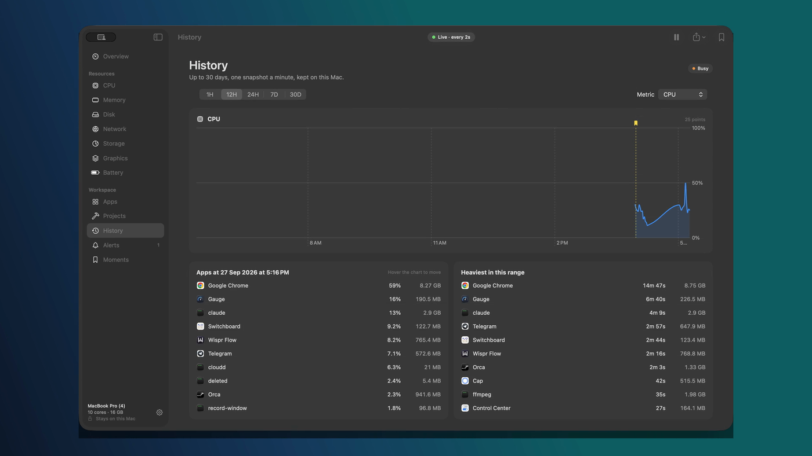
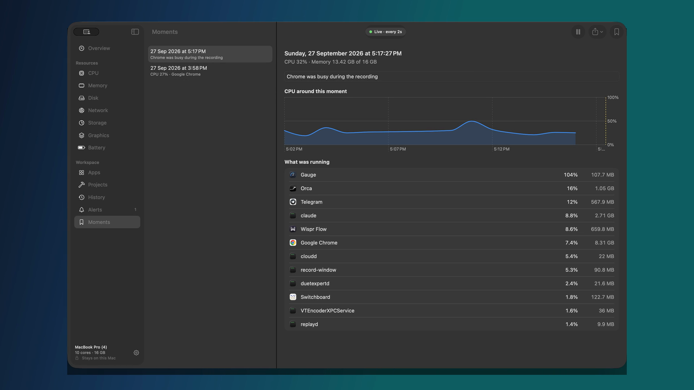

<div align="center">



[](LICENSE)
[](#requirements)
[](https://swift.org)
[](Package.swift)

**A native macOS activity monitor that explains itself.**

Shows what your Mac is doing, groups helper processes under the app that owns
them, and keeps 30 days of history — on your Mac only.
Free and open source. No account, no telemetry, no network access at all.



<sub>▶ <a href="https://github.com/lightwaslost/gauge/releases/latest">Watch the full 55-second tour</a></sub>

</div>

## Install

Download the latest `Gauge.dmg` from
[Releases](https://github.com/lightwaslost/gauge/releases), open it, and drag Gauge
into Applications.

Gauge is ad-hoc signed rather than notarised, so the first launch needs
**right-click → Open** (or Privacy & Security → Open Anyway). Building it
yourself avoids that entirely:

```bash
git clone https://github.com/lightwaslost/gauge.git
cd gauge
./scripts/build-app.sh         # → build/Gauge.app
```

## Features

- **Overview**: live cards for CPU, memory, network, disk, GPU and battery (click one for its page), a CPU chart, a memory breakdown and a sortable apps list.
- **Resource pages**: CPU (user/system, load), Memory (pressure, app/wired/compressed/cached, swap), Disk (volumes, per-app read/write), Network (per-interface traffic), Graphics (chip, GPU memory, thermal state) and Battery (health, cycles, temperature, watts, time left). Each has a 1/5/10-minute live chart you can hover.
- **Apps**: helpers grouped under the `.app` that owns them. Click an app for its processes, Quit, Force Quit, stop one process, or Show in Finder. "Include background" adds CLI tools and services.
- **Storage**: measures folders under home, `~/Library` and `/Applications`, shows a category donut and the largest folders, and lets you drill into any folder. The result is cached.
- **Projects**: dev runtimes and listening TCP ports, grouped by project folder, with open-in-browser and stop. Secrets in command lines are redacted.
- **History**: one averaged snapshot per minute, kept 30 days, with 1H to 30D charts for each metric, the apps at any hovered minute, and the heaviest apps in the range.
- **Alerts**: an app over a CPU threshold for a sustained time, or memory growth within an hour. Configurable, with optional macOS notifications.
- **Moments**: ⌘S saves what every app is doing, with a note and the surrounding CPU history.
- **Toolbar & menu bar**: live/paused indicator, pause (⇧⌘P), export a snapshot (Markdown) or history (CSV). The menu bar shows the metric and style you pick.
- **Settings**: launch at login, sampling rate with the window open vs closed, menu bar options, alert thresholds, data folder and clear history.

## Screenshots

|  |  |
|---|---|
|  **Overview** — every resource at a glance |  **CPU** — user vs system, load, live chart |
|  **Apps** — helpers grouped under their app |  **Storage** — where the disk actually went |
|  **History** — 1H to 30D, recorded locally |  **Moments** — ⌘S captures the whole machine |

## Privacy

There is no network code in this repository. Nothing is uploaded because there
is nowhere for it to go — no accounts, no analytics, no crash reporting, no
update check. Everything Gauge records lives in
`~/Library/Application Support/Gauge/`, and Settings → Data will show you the
folder or delete it.

Don't take our word for it: `grep -rn URLSession Sources/` comes back empty. The
only URLs in the source are the GitHub links in the About tab and the
`localhost` ports on the Projects page — both open in your browser, when you
click them.

## Requirements

macOS 26 or later, Xcode 26 / Swift 6.2 or later. No dependencies.

## Build and run

```bash
swift run                      # debug, from the terminal
swift run Gauge --self-test    # print every sampler's readings, no UI
./scripts/build-app.sh         # release build → build/Gauge.app (ad-hoc signed)
./scripts/build-app.sh --dmg   # also build/Gauge.dmg with an Applications shortcut
```

Launch at login and notifications need the built `.app`; they are inert under
`swift run`.

## How it works

| Area | Source |
|---|---|
| CPU | `host_statistics(HOST_CPU_LOAD_INFO)` tick deltas |
| Memory | `host_statistics64(HOST_VM_INFO64)`: app + wired + compressed (Activity Monitor's "Memory Used") |
| Network | `sysctl(NET_RT_IFLIST2)` 64-bit interface counters, loopback excluded |
| Disk | IOKit `IOBlockStorageDriver` statistics |
| GPU | IOKit `IOAccelerator` "Device Utilization %" (shown as unavailable if not reported) |
| Battery | IOKit power sources |
| Per process | `proc_pid_rusage` (CPU time, phys footprint, disk I/O) + `proc_pidpath` / `PROC_PIDTBSDINFO` for grouping |

Code layout: `Sources/Gauge/Sampling` (samplers), `Storage` (SQLite + history),
`Monitor.swift` (2-second timer, 1-minute snapshots), `Views`.

## Known limits

- Processes owned by other users (root daemons) aren't readable without a privileged helper, so they aren't shown.
- History isn't recorded while the Mac sleeps or Gauge is quit. The chart draws a straight line across those gaps.
- Builds are ad-hoc signed, not notarised with a Developer ID, so Gatekeeper warns on first launch.
- There are no in-app updates. Watch the repo for releases.

## Contributing

Issues and pull requests are welcome — see [CONTRIBUTING.md](CONTRIBUTING.md)
for the layout of the code and the one hard rule (Gauge never talks to the
network).

## Licence

[MIT](LICENSE) © 2026 Tanishq Mehta
